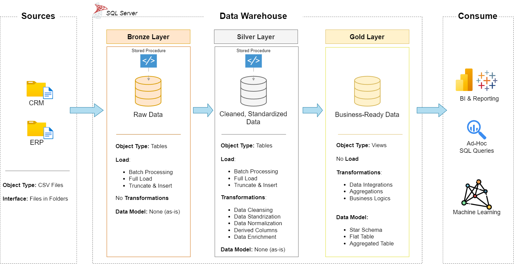

# 🏢 SQL Data Warehouse Project

A SQL Server data warehouse project that ingests, cleans, models, and analyzes sales data from CRM and ERP systems. The repository implements a medallion-style architecture (Bronze → Silver → Gold), with raw source files loaded into staging tables, transformed into clean analytical tables, and exposed through star-schema views for reporting and BI use cases.

---

## 🎯 Project Overview

This project demonstrates the full data engineering lifecycle:

1. 🏗️ Data architecture and layered warehouse design
2. 🔄 ETL pipeline development using SQL Server and CSV ingestion
3. 📐 Data modeling with dimension and fact objects in a star schema
4. 🧹 Data quality remediation and transformation logic
5. 📊 Analytical querying for business reporting and insights

### 🛠️ Skills Demonstrated
SQL Server · ETL Development · Data Modeling · Data Quality · Data Warehousing · Business Intelligence

---

## 🏛️ Architecture

The warehouse follows the Medallion Architecture pattern:

| Layer | Purpose | Object Type | Load Method |
|-------|---------|-------------|-------------|
| 🥉 Bronze | Raw source data loaded as-is from CRM and ERP CSV files | Tables | Batch load via BULK INSERT |
| 🥈 Silver | Cleaned, standardized, normalized, and deduplicated data | Tables | SQL-based transformation pipeline |
| 🥇 Gold | Business-ready analytical views for reporting | Views | Query layer over Silver |

**Data flow:** `CRM / ERP CSV files` → 🥉 `bronze` → 🥈 `silver` → 🥇 `gold` → `Reports / Analytics`



---

## 📁 Repository Structure

```text
sql-data-warehouse-project/
├── datasets/
│   ├── source_crm/
│   │   ├── cust_info.csv
│   │   ├── prd_info.csv
│   │   └── sales_details.csv
│   ├── source_erp/
│   │   ├── CUST_AZ12.csv
│   │   ├── LOC_A101.csv
│   │   └── PX_CAT_G1V2.csv
│   └── placeholder
├── docs/
│   ├── ETL.png
│   ├── Project_Notes_Sketches.pdf
│   ├── data_architecture.png
│   ├── data_catalog.md
│   ├── data_flow.png
│   ├── data_integration.png
│   ├── data_layers.pdf
│   ├── data_model.png
│   └── naming_conventions.md
├── scripts/
│   ├── initialize_database.sql
│   ├── bronze/
│   │   ├── ddl_bronze.SQL
│   │   └── load_procedure_bronze.sql
│   ├── silver/
│   │   ├── ddl_silver.sql
│   │   └── load_procedures_silver.sql
│   └── gold/
│       └── ddl_gold.sql
├── tests/
│   ├── silver_quality_checks.sql
│   └── gold_quality_checks.sql
├── README.md
└── .gitignore
```

---

## 📥 Data Sources

The project ingests data from two source systems:

- 🤝 **CRM**: customer details, product information, and sales transactions
- 🏭 **ERP**: location, customer demographic, and product category metadata

The raw data is stored under:

- `datasets/source_crm/`
- `datasets/source_erp/`

These files are loaded into the Bronze layer using SQL Server `BULK INSERT` operations.

---

## ⭐ Gold Layer Data Model

The Gold layer exposes a star schema optimized for reporting and analytics:

- `gold.dim_customers` — customer dimension enriched from CRM and ERP data
- `gold.dim_products` — product dimension with category and line metadata
- `gold.fact_sales` — sales fact table with transaction-level measures

The gold schema is created in `scripts/gold/ddl_gold.sql` and is built on top of the Silver layer.

---

## ⚙️ ETL Pipeline Highlights

### 🥉 Bronze Layer
- Loads raw CSV data into staging tables with `BULK INSERT`
- Preserves source fidelity with minimal transformation
- Tables created in `scripts/bronze/ddl_bronze.SQL`
- Loader stored procedure defined in `scripts/bronze/load_procedure_bronze.sql`

### 🥈 Silver Layer
- Trims whitespace and standardizes values
- Handles null and invalid cases
- Normalizes gender, marital status, and country codes
- Recalculates inconsistent sales and pricing values
- Builds clean, deduplicated business records
- Tables created in `scripts/silver/ddl_silver.sql`
- Transformation logic in `scripts/silver/load_procedures_silver.sql`

### 🥇 Gold Layer
- Joins CRM and ERP-derived data into business dimensions
- Generates surrogate keys using row-based logic
- Defines final analytical views for reporting
- Views created in `scripts/gold/ddl_gold.sql`

---

## 🚀 Getting Started

### ✅ Prerequisites
- [SQL Server](https://www.microsoft.com/en-us/sql-server/sql-server-downloads) (Express or any edition)
- [SSMS](https://learn.microsoft.com/en-us/sql/ssms/download-sql-server-management-studio-ssms) or Azure Data Studio
- [Git](https://git-scm.com/)

### 🔧 Setup and Execution

1. Clone the repository

```bash
git clone https://github.com/AdhishDatir/sql-data-warehouse-project.git
cd sql-data-warehouse-project
```

2. Create the database and schemas

Run `scripts/initialize_database.sql` in SSMS or Azure Data Studio.

This creates the `DataWarehouse` database and the `bronze`, `silver`, and `gold` schemas.

3. Update source file paths if needed

The Bronze loader reads from local CSV paths such as:

```sql
C:\SQL\sql-data-warehouse-project\datasets\source_crm\cust_info.csv
```

Update the paths in `scripts/bronze/load_procedure_bronze.sql` to match your local environment.

4. Run the ETL pipeline in order

Execute the SQL scripts in this sequence:

```sql
USE DataWarehouse;
GO

-- Create object definitions
EXECUTE dbo.sp_executesql @stmt = N'-- Run scripts/bronze/ddl_bronze.SQL';
EXECUTE dbo.sp_executesql @stmt = N'-- Run scripts/silver/ddl_silver.sql';
EXECUTE dbo.sp_executesql @stmt = N'-- Run scripts/gold/ddl_gold.sql';

-- Load data
EXEC bronze.load_bronze;
EXEC silver.load_silver;
```

The project currently defines the Bronze and Silver loaders as stored procedures, and the Gold layer as views created from the cleaned Silver data.

5. Validate the results

Run the quality checks in `tests/` to validate transformation output and integrity.

---

## 🧪 Testing and Validation

The repository includes focused SQL validation scripts:

- `tests/silver_quality_checks.sql` — validates the Silver layer transformations and data quality
- `tests/gold_quality_checks.sql` — validates the Gold layer views and star-schema logic

These checks cover areas such as:
- duplicate and null records
- invalid date values
- inconsistent sales/price calculations
- referential alignment in the Gold layer

---

## 📚 Documentation

The `docs/` folder contains project documentation and design assets:

- 🏗️ Architecture diagrams and ETL visuals
- ⭐ Data model and star schema references
- 🏷️ Naming conventions and standards
- 📖 Data catalog for Gold-layer objects

Relevant documents include:
- `docs/data_architecture.png`
- `docs/data_model.png`
- `docs/data_catalog.md`
- `docs/naming_conventions.md`

---

## 🏷️ Naming Conventions

The repository follows the naming conventions documented in `docs/naming_conventions.md`:

- **Style:** `snake_case`
- **Bronze/Silver objects:** `<source>_<entity>`
- **Gold objects:** `<category>_<entity>` such as `dim_customers`, `fact_sales`
- **Surrogate keys:** `<table>_key`
- **Stored procedures:** `load_<layer>`

---

## 👤 Author

**Adhish Datir**

[GitHub](https://github.com/AdhishDatir)

---
